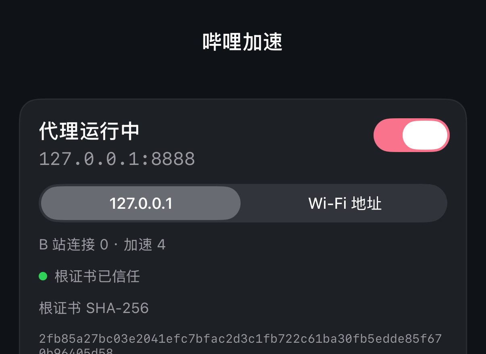
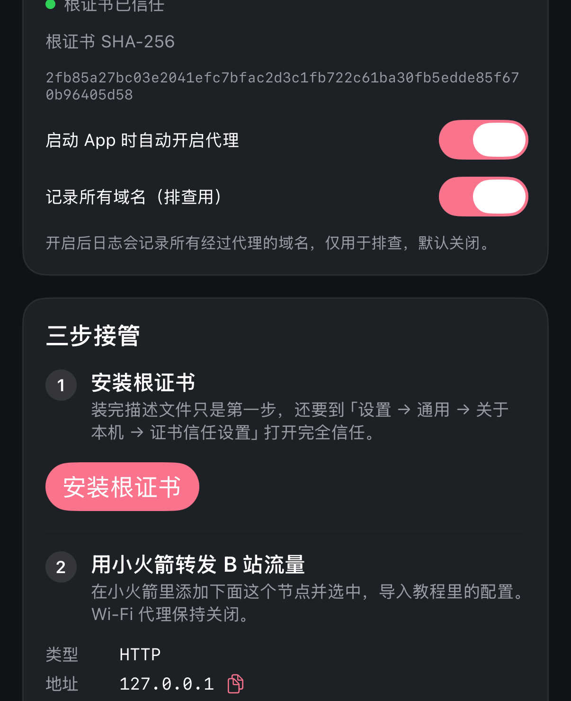
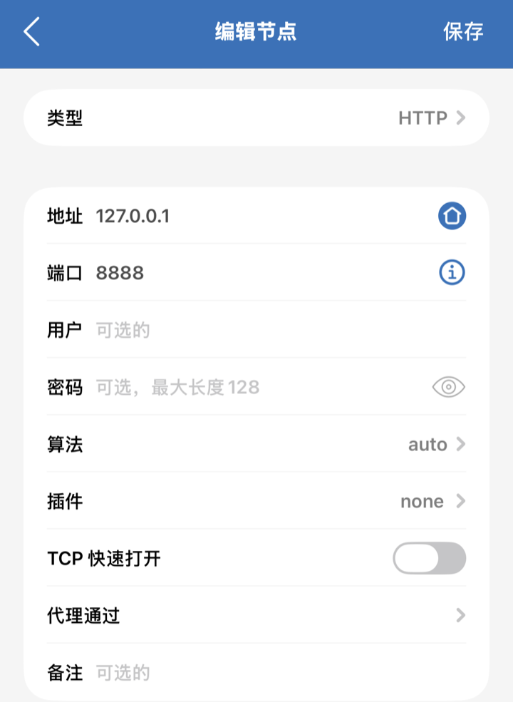
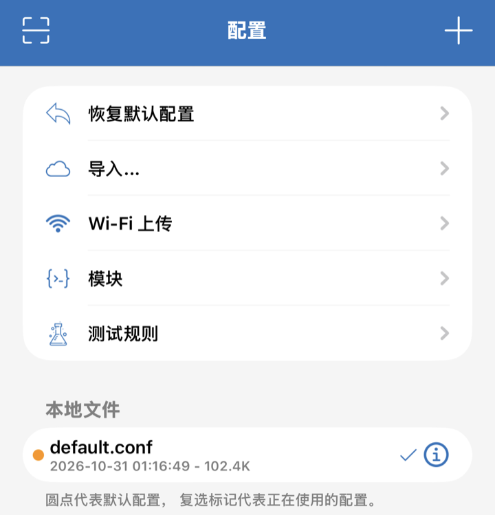
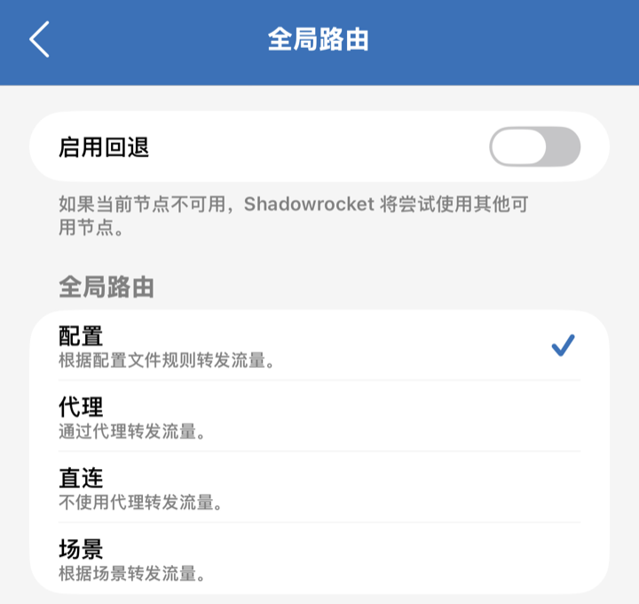
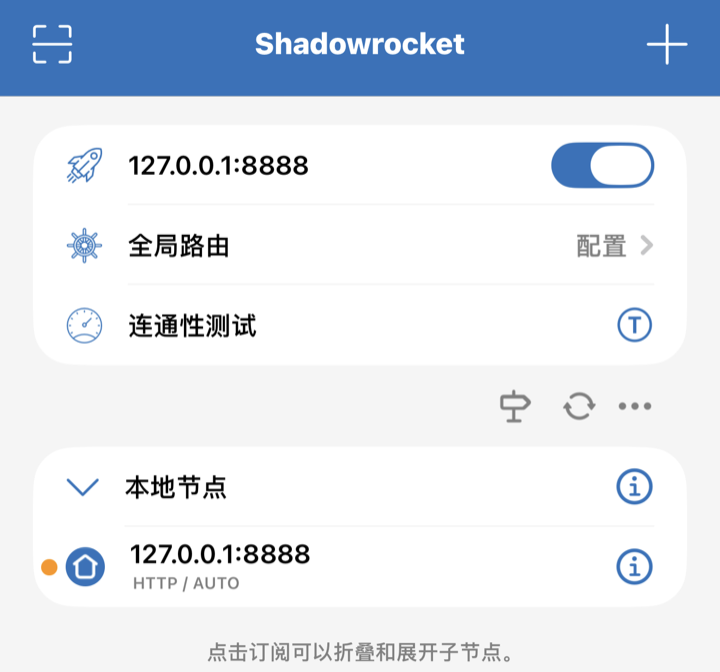
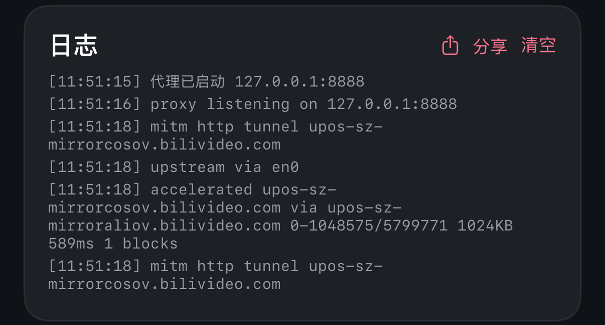

<div align="center">


# 哔哩加速

**让 iPhone 上的官方 B 站 App 也能多线程下载、多节点竞速**

把 [Bilibili 线程撕裂者](https://github.com/MrTangLuyao/Bilibili-thread-ripper) 的思路搬到 iOS 上，海外看冷门、高码率视频时减少卡顿

[安装](#-安装) · [怎么知道它在工作](#怎么知道它在工作) · [原理](#原理) · [常见问题](#常见问题) · [反馈问题](#反馈问题)

</div>

> [!NOTE]
> 本项目是非官方、实验性质的开源项目，与哔哩哔哩官方和线程撕裂者作者都没有关联。它不会绕过会员、登录、区域、清晰度、数字版权保护或媒体签名限制，仅供个人学习和自用。

> [!IMPORTANT]
> 这不是一个点一下就能用的 App。你需要一台 Mac 和 Xcode 自己安装，还要购买小火箭（Shadowrocket），并在手机上信任一张本地根证书。请先读完[使用前要知道的](#使用前要知道的)。

> [!TIP]
> 在电脑或 Mac 的浏览器上看 B 站，请直接用上游的[线程撕裂者油猴脚本](https://github.com/MrTangLuyao/Bilibili-thread-ripper)，不需要这个项目。

## 它解决什么问题

海外的网络明明很快，B 站的冷门视频和高码率视频却总是卡。官方 App 下载一段视频通常只走一条连接，这条连接又可能很慢。

哔哩加速在手机本地运行一个代理，提前用多条连接从多个 CDN 节点下载后面要播的内容，播放器来要时直接给。

- **多连接预读**：把视频分块，同时下载播放位置之后的内容
- **多节点选择**：每个文件都重新竞速，再按实测速度优选节点
- **卡住自动救援**：连接没数据就换节点，播放器在等的块会同时走两个节点
- **保留官方 App**：界面、弹幕、账号和清晰度都还是官方 App 自己的
- **只碰 B 站媒体**：其他 App 的流量不解密、不解析
- **不上传数据**：没有遥测，代理就在你的手机上

### 实测效果

这是作者的一次真机对比。两边是**不同的视频**，只测了一次，只能当作参考，不是严格的跑分。

| | 关闭加速 | 开启加速 |
| --- | --- | --- |
| 连续播放 | 6 秒开始卡，50 秒后又卡 | 没有卡 |
| 卡顿次数 | 3 次 | 1 次（拖动后） |
| 拖动后等待 | 21 秒 | 12 秒 |

## 使用前要知道的

| ✅ 可能明显改善 | ❌ 解决不了 |
| --- | --- |
| 海外看冷门视频或高码率视频 | 你的宽带本身跑不动当前码率 |
| 测速很快，但 B 站单连接很慢 | 所有节点都堵在同一个出口 |
| 不同 CDN 到你那里的线路差异很大 | 账号没有播放权限 |

还有这些限制：

- **要同时开两个 App**：小火箭和「哔哩加速」都要开着。只开小火箭时，B 站的视频和封面会加载失败。
- **免费签名 7 天过期**：到期要连上 Mac，用 Xcode 再安装一次。
- **小火箭要付费**：它不在中国区 App Store 上架，要用其他地区的 Apple ID 购买。
- **后台靠静音音频保活**：长时间后台运行还没有充分验证，所以这个 App 也基本过不了 App Store 审核，只能自己安装。
- **目前只在 iPhone 上跑通过**：蜂窝网络和 iPad 还没有实测。

## 📦 安装

### 第 1 步：准备

- 一台装了 Xcode 的 Mac，以及 iOS 17 或更新版本的 iPhone
- 一个 Apple ID，免费的就行
- 在 App Store 购买并安装 [Shadowrocket](https://apps.apple.com/app/shadowrocket/id932747118)

### 第 2 步：把 App 装到 iPhone

下载代码并打开工程：

```bash
git clone https://github.com/Terry1238832/BiliScope.git
```

```bash
open BiliScope/App/BiliScope.xcodeproj
```

然后：

1. 打开 Xcode → Settings → Accounts，登录你的 Apple ID。
2. 选中 BiliScope 这个 Target，打开 Signing & Capabilities，**Team** 选你自己的 Personal Team。
3. 把 **Bundle Identifier** 改成自己的唯一值，比如 `com.你的名字.biliscope`。
4. 连上 iPhone，在手机上打开 设置 → 隐私与安全性 → **开发者模式**，手机会重启。
5. 在 Xcode 顶部选中你的 iPhone，点 **Run**。
6. 第一次安装后，打开 设置 → 通用 → VPN 与设备管理 → 开发者 App，点你的 Apple ID，再点**信任**。

### 第 3 步：安装并信任根证书

打开「哔哩加速」，确认显示**代理运行中**：

<div align="center">

</div>

1. 在 App 里点**安装根证书**，Safari 会提示下载描述文件，点允许。
2. 打开 设置 → 通用 → VPN 与设备管理，安装刚下载的描述文件。
3. 打开 设置 → 通用 → 关于本机 → **证书信任设置**，打开 `BiliScope Root CA` 的完全信任。

> [!WARNING]
> 装完描述文件**不等于**已信任，第 3 点不能漏。回到 App 看到绿点“根证书已信任”才算完成。根证书由你的手机在本地生成，每台设备各有一张。

### 第 4 步：配置小火箭

App 里的第 2 步也写着要填的内容：

<div align="center">

</div>

**添加节点**：在小火箭首页点右上角 **+**。类型默认是 `Subscribe`，要先点开改成 **HTTP**，然后这样填：

| 项目 | 填写 |
| --- | --- |
| 类型 | HTTP |
| 地址 | `127.0.0.1` |
| 端口 | `8888` |
| 用户和密码 | 留空 |

点右上角**保存**，回到首页确认选中了这个节点。

<div align="center">

</div>

**导入配置**：打开底部的**配置**标签，点**导入…**（或右上角 **+**），粘贴下面的网址并下载。然后点新出现的 `shadowrocket-biliscope.conf`，选**使用配置**。

```text
https://raw.githubusercontent.com/Terry1238832/BiliScope/main/docs/shadowrocket-biliscope.conf
```

<div align="center">

</div>

> [!WARNING]
> 上图还没有导入，所以只有自带的 `default.conf`。导入后要确认**对勾在新配置上**：对勾代表正在使用的配置，圆点只代表默认配置。如果对勾还在 `default.conf` 上，加速不会生效。

如果导入失败，也可以把这些规则手动加到小火箭的配置里：

```text
AND,((PROTOCOL,UDP),(DEST-PORT,443)),REJECT
DOMAIN-SUFFIX,bilivideo.com,PROXY
DOMAIN-SUFFIX,bilivideo.cn,PROXY
DOMAIN-SUFFIX,hdslb.com,PROXY
DOMAIN-KEYWORD,upos-,PROXY
FINAL,DIRECT
```

> [!CAUTION]
> 不要把整个 `akamaized.net` 加进规则，只转发 `upos-*`。否则别的 App 的流量也会被送进代理。

**选择全局路由**：回到首页点**全局路由**，选**配置**，这样才会按上面的规则分流。

<div align="center">

</div>

**连接**：回到首页打开连接开关。Wi-Fi 设置里的“配置代理”要保持**关闭**。连接成功时是这样的：

<div align="center">

</div>

### 第 5 步：开始看

1. **彻底关掉 B 站 App**，再重新打开。这一步必须做，否则已有的连接不会走新规则。
2. 随便播一个视频。

## 怎么知道它在工作

回到「哔哩加速」看日志，出现 `accelerated` 就说明接管成功了：

<div align="center">

</div>

> 「哔哩加速」的截图是在模拟器里拍的，界面和真机一样；小火箭的截图来自真机。

| 日志内容 | 含义 |
| --- | --- |
| `upstream via en0` 和 `accelerated` | 正常工作（用蜂窝网络时网卡名字会不同） |
| `hedge #…` | 某一块慢了，正在加一个节点救援，偶尔出现是正常的 |
| `block failed …` | 某个节点失败了，已经换节点，偶尔出现是正常的 |
| `upstream via lo0` 或 `utun…` | 下载绕回了代理，见[常见问题](#常见问题) |
| `loop detected`、`relay refused` | 检测到循环转发，已被拦下，见[常见问题](#常见问题) |
| 一条 B 站记录都没有 | 流量没进来，检查小火箭是否已连接、配置和节点是否选对 |

App 里还有**运行诊断**按钮。其中“视频 CDN”一项返回 `HTTP 403` 是正常的，因为它访问的是 CDN 根路径，这说明网络是通的。

## 原理

### 多连接预读

B 站播放器一次只要大约 1 MB，要完一段才要下一段。把这 1 MB 再切细没有意义：实测切成 8 条 128 KB 的新连接并不比一条连接快，时间都花在握手和 TCP 慢启动上了。

所以这里按 1 MB 分块，提前下载播放位置之后的内容。默认最多同时下载 8 块，播放器来要时直接给。

```mermaid
flowchart TD
    A["B 站播放器要下一段视频"] --> B["小火箭把视频连接转给本机 127.0.0.1:8888"]
    B --> C["哔哩加速收到请求"]
    C --> D{"这一块下好了吗"}
    D -- "下好了" --> E["立刻交给播放器"]
    D -- "没有" --> F["同时走两个节点，谁先完成用谁"]
    F --> E
    C --> G["后台继续提前下载后面的内容"]
    G --> H1["节点 A"] & H2["节点 B"] & H3["节点 C"]
```

### 为什么必须用小火箭

只把 Wi-Fi 代理指向本机是不够的。实测官方 App 只有 API 类流量走系统代理，视频和封面连接一次都没有进来。小火箭通过 VPN 抓到这些流量，再按规则只把 B 站媒体转给本机代理，其余流量照常直连。

### 接管范围

只有以下域名会被接管：`*.bilivideo.com`、`*.bilivideo.cn`、`*.hdslb.com`、`*.bilicdn.com`，以及 `upos-*-mirror*.akamaized.net`。

其他域名（包括 B 站 API、其他 App 和其他网站）如果进了代理，也只做字节转发，不解密、不解析。域名白名单写死在代码里，不能在运行时添加。

### 代码来源

这个项目参考了线程撕裂者的思路，但没有复制它的代码。上游是运行在浏览器里的 JavaScript，这里是全新的 Swift 实现：用 SwiftNIO 接收连接，用 Network.framework 下载。

## 常见问题

<details>
<summary><b>能不能解除地区、会员或者登录限制？</b></summary>

不能。它只优化你本来就有权访问的媒体数据，不绕过任何播放权限。

</details>

<details>
<summary><b>开了之后 B 站视频和封面都加载不出来？</b></summary>

最常见的原因是「哔哩加速」没在运行或被系统杀掉了。重新打开它，确认显示“代理运行中”。如果不想用了，直接关掉小火箭的连接开关，手机就恢复直连了。

</details>

<details>
<summary><b>打开或拖动视频时还是要等几秒？</b></summary>

这是目前已知的问题。拖动后的位置没有预读，只能现下。实测中还有一部分等待来自 B 站播放器自己的行为，代理改变不了。连续播放的改善会比拖动明显。

</details>

<details>
<summary><b>日志里出现 `loop detected` 或 `upstream via lo0`？</b></summary>

说明下载请求绕回了代理。先确认你用的是最新代码。小火箭开启时，系统会返回 `198.18.x.x` 这样的假 IP，代理必须指定物理网卡才能出去。如果手机暂时没有可用的 Wi-Fi 或蜂窝网络，也可能出现这种情况。

</details>

<details>
<summary><b>App 打不开，提示 “Developer App Certificate is not trusted”？</b></summary>

这是签名没被信任，和根证书是两回事。到 设置 → 通用 → VPN 与设备管理 → 开发者 App，点你的 Apple ID，再点信任。如果距离上次安装已经超过 7 天，就连上 Mac 重新 Run 一次。

</details>

<details>
<summary><b>信任一张根证书安全吗？</b></summary>

这张证书能让持有私钥的人冒充网站，所以请认真对待。它由 App 在你的手机上生成，私钥只保存在 App 自己的沙盒里，不会上传。不用的时候建议删掉：到 设置 → 通用 → VPN 与设备管理 删除 `BiliScope Root CA`。

</details>

<details>
<summary><b>会不会上传 Cookie、播放记录或者视频内容？</b></summary>

不会。项目没有遥测，也没有自己的服务器。`*.bilivideo.com` 等媒体域名的请求会在本地解开，再原样发给 B 站的 CDN。日志只保存在手机上，也不记录带签名的查询参数。

</details>

<details>
<summary><b>能上架 App Store 或者拿来卖吗？</b></summary>

不建议。静音音频保活、安装根证书和依赖第三方 VPN，都很难通过审核。这个项目的定位是个人自用的实验工具。

</details>

## 反馈问题

只说一句“没效果”很难判断原因。反馈时最好带上这些信息：

- [ ] iPhone 型号、iOS 版本和 B 站 App 版本
- [ ] 所在国家或地区、网络运营商，用的是 Wi-Fi 还是蜂窝网络
- [ ] 视频的清晰度，以及是起播慢、连续播放卡，还是拖动后卡
- [ ] 不开加速时同类视频的表现
- [ ] App 的日志：点日志卡片的**分享**，或在 文件 App → 我的 iPhone → 哔哩加速 → `BiliScope.log` 里找

> [!CAUTION]
> 请不要公开 Cookie、访问令牌或者完整的媒体签名地址。公开日志前也看一眼内容，如果开过“记录所有域名”，里面会有其他 App 访问的域名。

## 开发

想改代码或了解技术细节，请看 [README](README.md)。

```bash
swift test
```

如果增删了 App 里的源文件，需要用 XcodeGen 重新生成工程：

```bash
cd App && xcodegen generate
```

## 致谢与开源协议

- 思路来自 [MrTangLuyao/Bilibili-thread-ripper](https://github.com/MrTangLuyao/Bilibili-thread-ripper)（MIT）
- 使用了 [SwiftNIO](https://github.com/apple/swift-nio) 和 [swift-nio-ssl](https://github.com/apple/swift-nio-ssl)

项目采用 [MIT 开源协议](LICENSE)。
