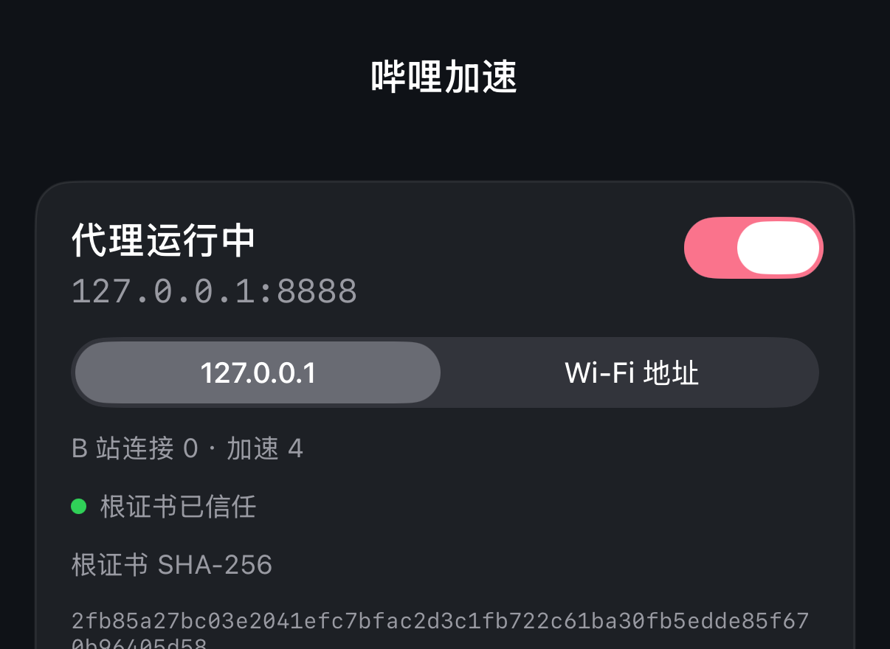
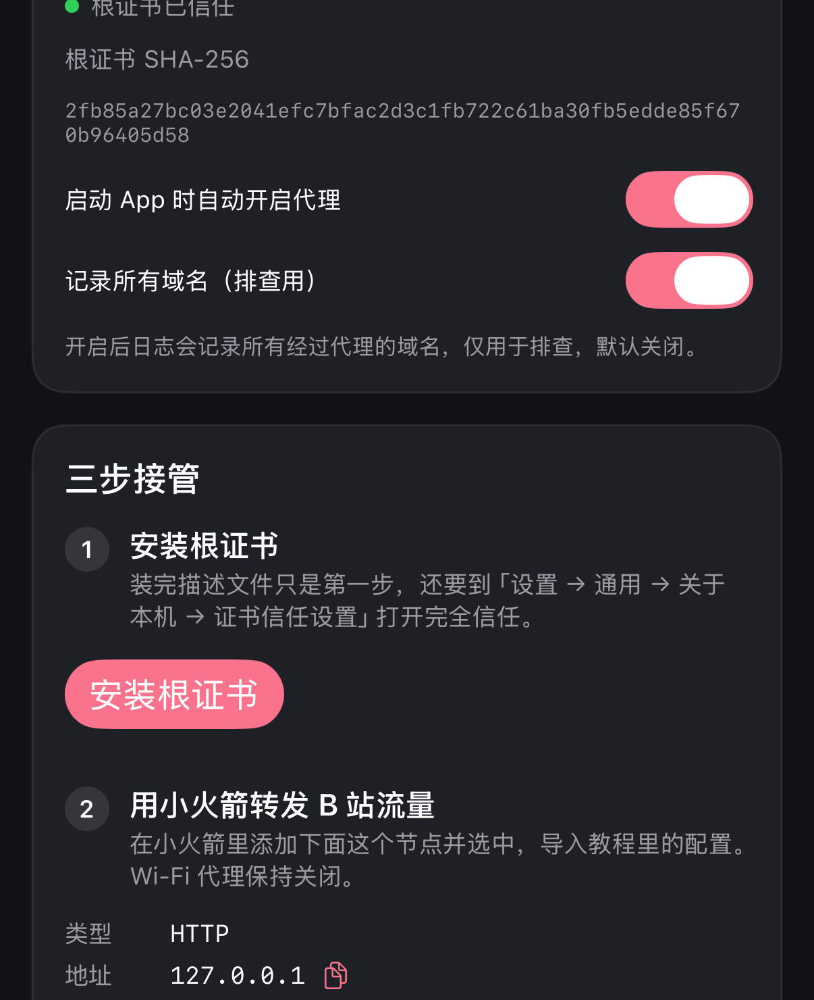
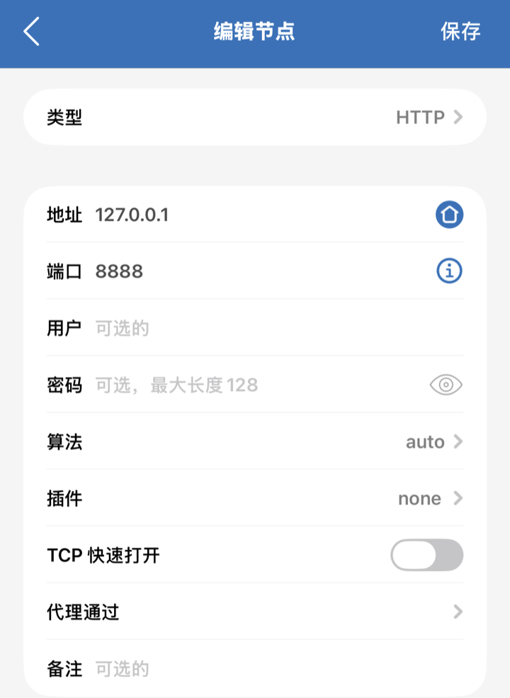
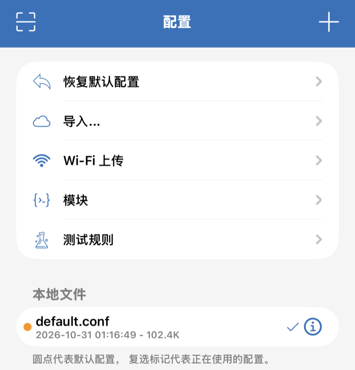
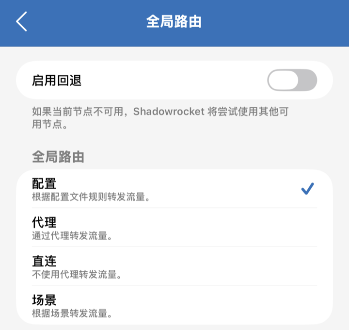
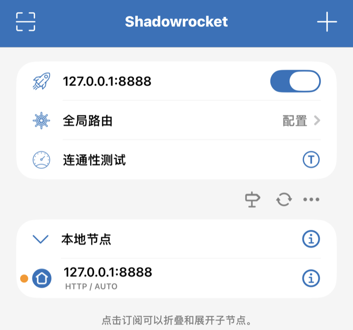
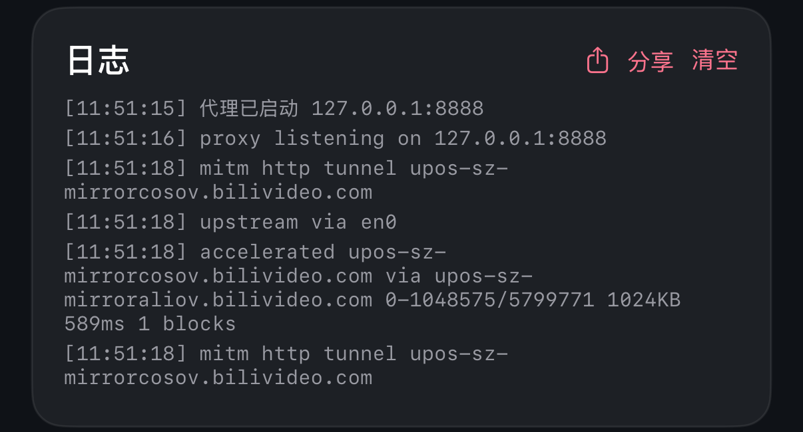
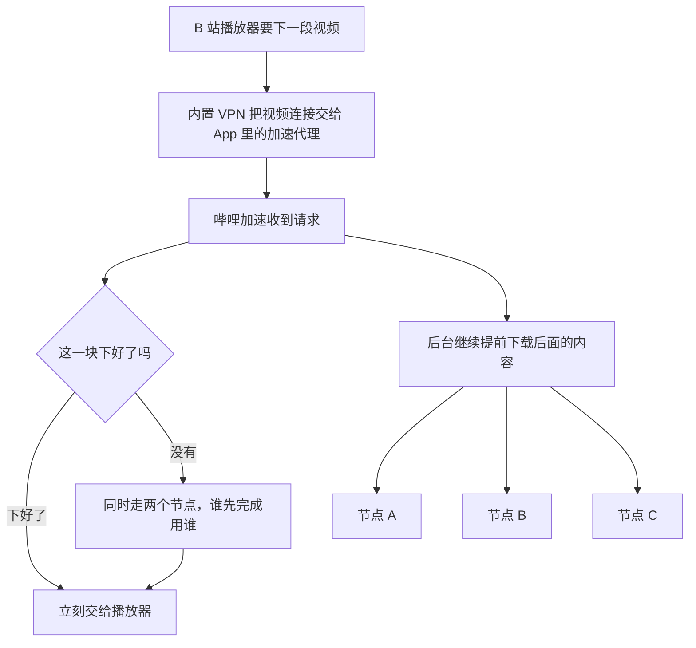

<div align="center">


# 哔哩加速

**让 iPhone 上的官方 B 站 App 也能多线程下载、多节点竞速**

把 [Bilibili 线程撕裂者](https://github.com/MrTangLuyao/Bilibili-thread-ripper) 的思路搬到 iOS 上，海外看冷门、高码率视频时减少卡顿

[安装](#-安装) · [怎么知道它在工作](#怎么知道它在工作) · [原理](#原理) · [常见问题](#常见问题) · [反馈问题](#反馈问题)

</div>

> [!NOTE]
> 本项目是非官方、实验性质的开源项目，与哔哩哔哩官方和线程撕裂者作者都没有关联。它不会绕过会员、登录、区域、清晰度、数字版权保护或媒体签名限制，仅供个人学习和自用。

> [!IMPORTANT]
> 这不是一个点一下就能用的 App。你需要一台 Mac 和 Xcode 自己安装，并在手机上信任一张本地根证书。App 自带的 VPN 需要**付费的 Apple 开发者账号**；只有免费账号的话，可以改用小火箭（Shadowrocket），见[备选方案](#备选没有付费开发者账号时用小火箭)。请先读完[使用前要知道的](#使用前要知道的)。

> [!TIP]
> 在电脑或 Mac 的浏览器上看 B 站，请直接用上游的[线程撕裂者油猴脚本](https://github.com/MrTangLuyao/Bilibili-thread-ripper)，不需要这个项目。

## 它解决什么问题

海外的网络明明很快，B 站的冷门视频和高码率视频却总是卡。官方 App 下载一段视频通常只走一条连接，这条连接又可能很慢。

哔哩加速自带一个只接管 B 站视频的 VPN，在手机本地提前用多条连接从多个 CDN 节点下载后面要播的内容，播放器来要时直接给。

- **多连接预读**：把视频分块，同时下载播放位置之后的内容
- **多节点选择**：每个文件都重新竞速，再按实测速度优选节点
- **卡住自动救援**：连接没数据就换节点，播放器在等的块会同时走两个节点
- **保留官方 App**：界面、弹幕、账号和清晰度都还是官方 App 自己的
- **只碰 B 站媒体**：其他 App 的流量不解密、不解析
- **不上传数据**：没有遥测，代理就在你的手机上

### 实测效果

这是作者在海外的一次真机对比：**同一个高码率视频、同一清晰度**，各播约 1 分钟。只测了一次，只能当作参考，不是严格的跑分。

| | 关闭加速 | 开启内置加速 |
| --- | --- | --- |
| 下载速度 | 0 KB/s，完全播不了 | 能持续播放 |
| 1 分钟内卡顿 | 一直卡着 | 0 次 |

在这之前的一个版本，同样的测试里开启加速后 1 分钟卡了 6 次，原因是节点探测用在了播放器正在等的块上，后来修掉了。

## 使用前要知道的

| ✅ 可能明显改善 | ❌ 解决不了 |
| --- | --- |
| 海外看冷门视频或高码率视频 | 你的宽带本身跑不动当前码率 |
| 测速很快，但 B 站单连接很慢 | 所有节点都堵在同一个出口 |
| 不同 CDN 到你那里的线路差异很大 | 账号没有播放权限 |

还有这些限制：

- **需要付费开发者账号**：内置 VPN 用的是 Network Extension，免费账号签不了。付费账号的签名一年有效。
- **只能开一个 VPN**：iOS 同时只允许一个 VPN，打开内置加速会断开小火箭之类的其他 VPN。
- **只接管 B 站**：VPN 只负责 B 站的媒体域名和阿里云 HTTPDNS，其他 App 的流量不经过它。
- **过不了 App Store 审核**：要信任本地根证书，还要改写 HTTPDNS，只适合自己安装使用。
- **目前只在 iPhone 和 Wi-Fi 上测过**：蜂窝网络和 iPad 还没有实测。

## 📦 安装

### 第 1 步：准备

- 一台装了 Xcode 的 Mac，以及 iOS 17 或更新版本的 iPhone
- 一个**付费的 Apple 开发者账号**（内置 VPN 需要）
- 只有免费账号的话，另外在 App Store 购买 [Shadowrocket](https://apps.apple.com/app/shadowrocket/id932747118)，按[备选方案](#备选没有付费开发者账号时用小火箭)使用

### 第 2 步：把 App 装到 iPhone

下载代码并打开工程：

```bash
git clone https://github.com/Terry1238832/BiliScope.git
```

```bash
open BiliScope/App/BiliScope.xcodeproj
```

然后：

1. 打开 Xcode → Settings → Accounts，登录你的 Apple ID。
2. 打开 Signing & Capabilities，给 **BiliScope** 和 **BiliScopeTunnel** 两个 Target 都选上你的 **Team**。
3. 把 BiliScope 的 **Bundle Identifier** 改成自己的唯一值，比如 `com.你的名字.biliscope`；BiliScopeTunnel 的要改成它加上 `.tunnel`，比如 `com.你的名字.biliscope.tunnel`。
4. 连上 iPhone，在手机上打开 设置 → 隐私与安全性 → **开发者模式**，手机会重启。
5. 在 Xcode 顶部选中你的 iPhone，点 **Run**。
6. 第一次安装后，打开 设置 → 通用 → VPN 与设备管理 → 开发者 App，点你的 Apple ID，再点**信任**。

### 第 3 步：安装并信任根证书

打开「哔哩加速」，确认显示**代理运行中**：

<div align="center">

</div>

1. 在 App 里点**安装根证书**，Safari 会提示下载描述文件，点允许。
2. 打开 设置 → 通用 → VPN 与设备管理，安装刚下载的描述文件。
3. 打开 设置 → 通用 → 关于本机 → **证书信任设置**，打开 `BiliScope Root CA` 的完全信任。

> [!WARNING]
> 装完描述文件**不等于**已信任，第 3 点不能漏。回到 App 看到绿点“根证书已信任”才算完成。根证书由你的手机在本地生成，每台设备各有一张。

### 第 4 步：打开内置加速

1. 在「哔哩加速」顶部打开**内置加速**。
2. 第一次打开时，iOS 会弹出“哔哩加速想要添加 VPN 配置”，点**允许**并输入锁屏密码。
3. 状态变成**已连接**就好了。手机顶部也会出现 VPN 图标。

Wi-Fi 设置里的“配置代理”要保持**关闭**。如果之前在用小火箭，打开内置加速时它会自动断开。

### 第 5 步：开始看

1. **彻底关掉 B 站 App**，再重新打开。这一步必须做，否则 B 站会沿用之前查到的服务器地址。
2. 随便播一个视频。

不用的时候，在「哔哩加速」里关掉内置加速，或者到 设置 → VPN 断开。

### 备选：没有付费开发者账号时用小火箭

免费账号签不了内置 VPN，所以要装不带 VPN 的**小火箭版**：在第 2 步里，Xcode 顶部的 Scheme 选 **BiliScopeLite**，只给它选 Team，再点 Run。然后让小火箭把 B 站流量转给它。这时「哔哩加速」自己要开着“代理运行中”，并且要按第 3 步信任根证书。

> [!NOTE]
> 小火箭版是单独的 App（Bundle ID 以 `.lite` 结尾），和完整版可以同时装着。用免费账号签名的流程作者没有实测过。


App 里的第 2 步也写着要填的内容：

<div align="center">

</div>

**添加节点**：在小火箭首页点右上角 **+**。类型默认是 `Subscribe`，要先点开改成 **HTTP**，然后这样填：

| 项目 | 填写 |
| --- | --- |
| 类型 | HTTP |
| 地址 | `127.0.0.1` |
| 端口 | `8888` |
| 用户和密码 | 留空 |

点右上角**保存**，回到首页确认选中了这个节点。

<div align="center">

</div>

**导入配置**：打开底部的**配置**标签，点**导入…**（或右上角 **+**），粘贴下面的网址并下载。然后点新出现的 `shadowrocket-biliscope.conf`，选**使用配置**。

```text
https://raw.githubusercontent.com/Terry1238832/BiliScope/main/docs/shadowrocket-biliscope.conf
```

<div align="center">

</div>

> [!WARNING]
> 上图还没有导入，所以只有自带的 `default.conf`。导入后要确认**对勾在新配置上**：对勾代表正在使用的配置，圆点只代表默认配置。如果对勾还在 `default.conf` 上，加速不会生效。

如果导入失败，也可以把这些规则手动加到小火箭的配置里：

```text
AND,((PROTOCOL,UDP),(DEST-PORT,443)),REJECT
DOMAIN-SUFFIX,bilicdn.com,PROXY
DOMAIN-SUFFIX,bilicdn1.com,PROXY
DOMAIN-SUFFIX,bilicdn2.com,PROXY
DOMAIN-SUFFIX,bilicdn3.com,PROXY
DOMAIN-SUFFIX,bilicdn4.com,PROXY
DOMAIN-SUFFIX,bilicdn5.com,PROXY
DOMAIN-SUFFIX,biliimg.com,PROXY
DOMAIN-SUFFIX,bilivideo.cn,PROXY
DOMAIN-SUFFIX,bilivideo.com,PROXY
DOMAIN-SUFFIX,bilivideo.net,PROXY
DOMAIN-SUFFIX,hdslb.com,PROXY
DOMAIN-SUFFIX,hdslb.org,PROXY
DOMAIN-SUFFIX,maoercdn.com,PROXY
DOMAIN-SUFFIX,mincdn.com,PROXY
DOMAIN,upos-hz-mirrorakam.akamaized.net,PROXY
FINAL,DIRECT
```

> [!CAUTION]
> 不要把整个 `akamaized.net` 加进规则，只用 `DOMAIN` 完整匹配 `upos-hz-mirrorakam.akamaized.net`。否则别的 App 的流量也会被送进代理。

**选择全局路由**：回到首页点**全局路由**，选**配置**，这样才会按上面的规则分流。

<div align="center">

</div>

**连接**：回到首页打开连接开关。Wi-Fi 设置里的“配置代理”要保持**关闭**。连接成功时是这样的：

<div align="center">

</div>

**开始看**：彻底关掉 B 站 App 再重新打开。

> [!WARNING]
> 用小火箭时，免费账号的签名 7 天过期，到期要连上 Mac 重新安装。「哔哩加速」被系统杀掉后，B 站的视频和封面会加载失败，这时重新打开它，或者关掉小火箭的连接开关。

## 怎么知道它在工作

回到「哔哩加速」看日志，出现 `accelerated` 就说明接管成功了。内置加速打开时，日志卡片显示的是 VPN 里的日志：

<div align="center">

</div>

> 「哔哩加速」的截图是在模拟器里拍的，来自小火箭版本，界面和现在略有不同；小火箭的截图来自真机。

| 日志内容 | 含义 |
| --- | --- |
| `upstream via en0` 和 `accelerated` | 正常工作（用蜂窝网络时网卡名字会不同） |
| `httpdns rewrote …` | B 站查询视频服务器时，答案被指向了 VPN，正常 |
| `bare ip 198.18.200.1:80 carries upos-…` | 播放器的视频连接进了 VPN，正常 |
| `hedge #…` | 某一块慢了，正在加一个节点救援，偶尔出现是正常的 |
| `block failed …` | 某个节点失败了，已经换节点，偶尔出现是正常的 |
| `upstream via lo0` 或 `utun…` | 下载绕回了代理，见[常见问题](#常见问题) |
| `loop detected`、`relay refused` | 检测到循环转发，已被拦下，见[常见问题](#常见问题) |
| 一条 B 站记录都没有 | 流量没进来：确认内置加速已连接，并且彻底重开过 B 站 |

App 里还有**运行诊断**按钮。其中“视频 CDN”一项返回 `HTTP 403` 是正常的，因为它访问的是 CDN 根路径，这说明网络是通的。

## 原理

### 多连接预读

B 站播放器一次只要大约 1 MB，要完一段才要下一段。把这 1 MB 再切细没有意义：实测切成 8 条 128 KB 的新连接并不比一条连接快，时间都花在握手和 TCP 慢启动上了。

所以这里按 1 MB 分块，提前下载播放位置之后的内容。内置加速最多同时下载 10 块，播放器来要时直接给。



### 内置 VPN 怎么只接管 B 站

只把 Wi-Fi 代理指向本机是不够的：实测官方 App 只有 API 类流量走系统代理，视频连接一次都没有进来。所以 App 自带了一个 VPN，但它只处理 B 站：

1. **系统 DNS**：只有 B 站媒体域名会被解析到 VPN 里的地址，其他域名照常解析，所以其他 App 的流量不经过 VPN。
2. **B 站自己的 HTTPDNS**：实测 B 站播放器不问系统 DNS，而是向阿里云 HTTPDNS 查询视频服务器的 IP，再直接连接。所以 VPN 也接管了阿里云 HTTPDNS：查询照常转发，只把 B 站视频域名的答案改成 VPN 里的一个地址，其他域名和其他 App 的查询原样返回。改写失败时也原样返回，最坏只是这次没加速。
3. **还原连接**：进入 VPN 的流量由开源的 [hev-socks5-tunnel](https://github.com/heiher/hev-socks5-tunnel) 还原成 TCP 连接，按请求里的域名交给加速代理。
4. **下载**：加速代理直接从 Wi-Fi 或蜂窝网卡下载，不会绕回 VPN。

### 接管范围

**解密并加速**（含子域名）：`bilivideo.com`、`bilivideo.cn`、`bilivideo.net`、`hdslb.com`、`hdslb.org`、`biliimg.com`，以及只按完整域名匹配的 `upos-hz-mirrorakam.akamaized.net`。

**进入 VPN 但只转发、不解密**：`bilicdn.com`、`bilicdn1.com` 到 `bilicdn5.com`、`maoercdn.com`、`mincdn.com`。这些域名上有 B 站 App 的接口，B 站不接受本地证书，解密它们会导致无法播放。

其他域名（包括其他 App 和其他网站）不进入 VPN；即使用小火箭转进了代理，也只做字节转发，不解密、不解析。域名白名单写死在代码里，不能在运行时添加。

### 代码来源

这个项目参考了线程撕裂者的思路和它的 CDN 节点表，但没有复制它的代码。上游是运行在浏览器里的 JavaScript，这里是全新的 Swift 实现：用 SwiftNIO 接收连接，用 Network.framework 下载。VPN 里的 hev-socks5-tunnel 是从源码自己编译的，脚本在 `scripts/build-hev-xcframework.sh`。

## 常见问题

<details>
<summary><b>能不能解除地区、会员或者登录限制？</b></summary>

不能。它只优化你本来就有权访问的媒体数据，不绕过任何播放权限。

</details>

<details>
<summary><b>开了之后 B 站视频和封面都加载不出来？</b></summary>

先在「哔哩加速」里关掉内置加速，或者到 设置 → VPN 断开，B 站会马上恢复直连。然后确认根证书仍然是“已信任”，再重新打开内置加速，并彻底重开 B 站。用小火箭的话，最常见的原因是「哔哩加速」被系统杀掉了：重新打开它，或者关掉小火箭的连接开关。

</details>

<details>
<summary><b>打开或拖动视频时还是要等几秒？</b></summary>

这是目前已知的问题。拖动后的位置没有预读，只能现下。实测中还有一部分等待来自 B 站播放器自己的行为，代理改变不了。连续播放的改善会比拖动明显。

</details>

<details>
<summary><b>日志里出现 `loop detected` 或 `upstream via lo0`？</b></summary>

说明下载请求绕回了代理。先确认你用的是最新代码。VPN 开启时，系统会把 B 站媒体域名解析成 `198.18.x.x` 这样的地址，代理必须指定 Wi-Fi 或蜂窝网卡才能出去。如果手机暂时没有可用的 Wi-Fi 或蜂窝网络，也可能出现这种情况。

</details>

<details>
<summary><b>App 打不开，提示 “Developer App Certificate is not trusted”？</b></summary>

这是签名没被信任，和根证书是两回事。到 设置 → 通用 → VPN 与设备管理 → 开发者 App，点你的 Apple ID，再点信任。签名过期了（付费账号一年，免费账号 7 天）就连上 Mac 重新 Run 一次。

</details>

<details>
<summary><b>信任一张根证书安全吗？</b></summary>

这张证书能让持有私钥的人冒充网站，所以请认真对待。它由 App 在你的手机上生成，不会上传。打开内置加速时，App 会把它交给自己的 VPN 扩展，保存在扩展的沙盒和系统的 VPN 配置里。不用的时候建议删掉：到 设置 → 通用 → VPN 与设备管理 删除 `BiliScope Root CA`，并在 设置 → VPN 里删除哔哩加速的配置。

</details>

<details>
<summary><b>会不会上传 Cookie、播放记录或者视频内容？</b></summary>

不会。项目没有遥测，也没有自己的服务器。`*.bilivideo.com` 等媒体域名的请求会在本地解开，再原样发给 B 站的 CDN。日志只保存在手机上，也不记录带签名的查询参数。

</details>

<details>
<summary><b>能上架 App Store 或者拿来卖吗？</b></summary>

不建议。安装本地根证书、改写 HTTPDNS 和解密另一家 App 的流量，都很难通过审核，也有平台规则方面的风险。这个项目的定位是个人自用的实验工具。

</details>

## 反馈问题

只说一句“没效果”很难判断原因。反馈时最好带上这些信息：

- [ ] iPhone 型号、iOS 版本和 B 站 App 版本
- [ ] 所在国家或地区、网络运营商，用的是 Wi-Fi 还是蜂窝网络
- [ ] 视频的清晰度，以及是起播慢、连续播放卡，还是拖动后卡
- [ ] 不开加速时同类视频的表现
- [ ] App 的日志：点日志卡片的**分享**，或在 文件 App → 我的 iPhone → 哔哩加速 → `BiliScope.log` 里找

> [!CAUTION]
> 请不要公开 Cookie、访问令牌或者完整的媒体签名地址。公开日志前也看一眼内容，如果开过“记录所有域名”，里面会有其他 App 访问的域名。

## 开发

想改代码或了解技术细节，请看 [README](README.md)。

```bash
swift test
```

如果增删了 App 里的源文件，需要用 XcodeGen 重新生成工程：

```bash
cd App && xcodegen generate
```

## 致谢与开源协议

- 思路来自 [MrTangLuyao/Bilibili-thread-ripper](https://github.com/MrTangLuyao/Bilibili-thread-ripper)（MIT）
- 使用了 [SwiftNIO](https://github.com/apple/swift-nio) 和 [swift-nio-ssl](https://github.com/apple/swift-nio-ssl)

项目采用 [MIT 开源协议](LICENSE)。
